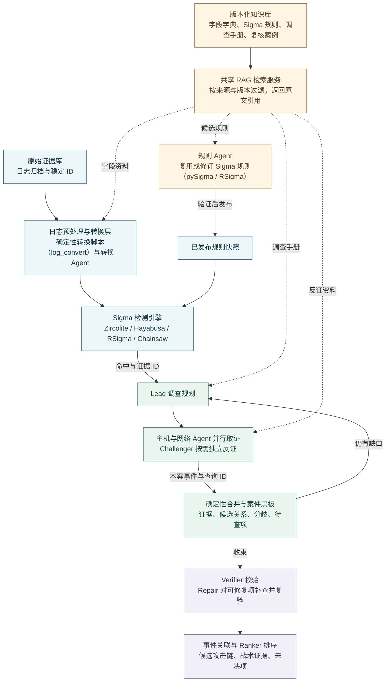

# 基于 Sigma 的多 Agent 日志调查系统设计

本系统接收主机和网络日志，通过 Sigma 规则定位可疑事件。调查 Agent 从命中记录出发，沿进程、会话和连接查找上下文。分析员最终获得候选攻击链、各战术的关键证据和仍需核实的关系。

## 系统结构

实线表示日志、规则快照和案件证据的流向。虚线表示 Agent 按需获取参考资料。调查角色通过只读取证工具回查原始证据库。

查看可编辑的 Mermaid 图源

### 运行单位与交付

每次运行绑定一个案件、一个数据快照、一组规则版本和一个知识库快照。输入可以是已知格式的原始记录、经映射的自定义日志，或分析员指定的调查起点。输出按候选攻击链排序，每条结论可定位到原始记录。组织归属留给具有额外情报的后续分析。

## 日志接入与 Sigma 检测

接入层处理两件事。首先看引擎能否读入记录，再看这批记录能否提供规则要求的观测。

### 从原始记录建立可回查的事件

采集器先将原始批次存入证据库，保存来源、内容摘要和定位符，例如文件与行号、字节偏移或 EVTX 记录号。持久化完成后发布批次引用，内存只保存当前待处理批次，重启后按已提交位置重放。

同一来源记录在本案重放时复用 `raw_id`。一条记录展开为多个事件时，各 `event_id` 包含稳定的子事件标识，共同指向 `raw_id`。时间统一为 UTC，保留原时区与时间精度。来源不明的时区、缺失的命令行或进程标识均保留为未知。

| 输入情形 | 预处理动作 | 交给检测层的结果 |
| --- | --- | --- |
| 已识别的日志源（6 类格式 / 16 种日志） | 复用已实现的确定性转换工具集 [script/log_convert/](../script/log_convert/README.md)（共享流式解析器 `lib/parsers.py` + 引擎专属格式化器 `lib/formatters.py`），统一 UTC `@timestamp` 并注入可复现的 `raw_id` / `event_id`；在比赛场景中由接入层同步绑定 `physical_record_id ↔ raw_id ↔ event_id`。 | 按目标引擎生成的规范化事件文件（JSONL / NDJSON / JSON 数组）、原始定位、反查索引与映射版本。 |
| 未知文本或私有字段 | 转换 Agent 先按产品与版本检索字段字典和已验证映射，再根据样本提出转换方案。用样本核对字段含义、类型、时间和记录数。 | 通过后登记映射版本。失败记录保留原文和原因。 |
| 规则与数据不匹配 | 核对 `logsource`、规则条件中各分支的可用字段、关联键和引擎能力。 | 按规则记录可执行、部分覆盖或跳过及原因。 |

### 检测引擎与结果接口

规则以 Sigma YAML 管理。离线多 Agent 调查原型采用四组互补的检测与取证工具组合，前置由 [script/log_convert/](../script/log_convert/README.md) 完成 6 类原始日志向各引擎目标格式的确定性转换，由适配器按日志源和任务类型路由，避免引入重型在线 SIEM：

| 工具组件 | 职责定位 | 输入转换与输出契约 |
| --- | --- | --- |
| **Zircolite** | 统一离线扫描基线（首个接入目标）。 | 消费 `zircolite_*_jsonl.py`（全 6 类日志）产出的 SQLite 友好扁平 JSONL（避免大小写列冲突、列表标量化，保留 `event_id`/`raw_id`/`@timestamp`），配合 `configs/zircolite_config.yaml` 映射配置执行扫描，并维护引擎行号到 `event_id` 的精确映射。 |
| **Hayabusa + Takajo** | Windows 事件日志专项增强与结构化上下文提取。 | 除直接扫描原始 EVTX 外，通过 `hayabusa_winxml_jsonl.py` 将 Windows Security/Sysmon XML 转为 Hayabusa v4 `-J` 扁平 JSONL（供 `hayabusa dfir-timeline -J -t jsonl -p super-verbose` 扫描），并同步生成 `--index-out` 的 `(Computer, Channel, RecordID) → event_id` 回查索引（同时在 `ExtraFieldInfo` 保留 `event_id`）；Takajo 仅消费 Hayabusa 的 JSONL 时间线，确定性提取进程树、横向移动摘要与 IOC，供主机调查 Agent 回查并绑定原始 `event_id`。 |
| **pySigma + RSigma** | 规则校验、多后端转换与 Sigma v2 关联规则支持。 | `pySigma` 为静态规则库（不直接读日志），负责 Sigma YAML 的 AST 解析、Schema 校验与面向目标引擎/字段映射（Pipeline）的转换；`RSigma` 消费 `rsigma_*_ndjson.py`（全 6 类日志）产出的按 UTC `@timestamp` 升序排列的 NDJSON（保留原生数组、点分与下划线双字段及 `event_id`），配合 `configs/rsigma_pipeline.yml`（指定 `@timestamp` 与 `correlation_event_mode: full`）执行本地高速评估、Lint、原生 Sigma v2 关联规则，并可通过 MCP 接口供规则 Agent 调用校验。 |
| **Chainsaw** | Windows/多源日志高速 Sigma 狩猎与交叉验证引擎。 | 消费 `chainsaw_*_json.py`（全 6 类日志）产出的 `.json` 数组（满足 Chainsaw 2.18 `kind: json` 约束）：Windows 事件 JSON 兼容官方 `mappings/sigma-event-logs-json.yml`（`Provider`/`TimeCreated` 字符串化并保留 `*_attributes`），其余 5 类非 Windows 日志通过 `configs/chainsaw_custom_mapping.yml` 按 `log_source` 分组映射字段，均保留 `event_id`/`raw_id`/`source_file` 供回查；具备原始 EVTX 或磁盘取证制品（`$MFT`、注册表、SRUM）时亦可原生狩猎。 |

例如 Windows 的进程创建规则可检查 `ParentImage` 是否指向 WINWORD.EXE，同时检查 Image 是否指向 powershell.exe。每条 Hit 保存 `rule_id`、规则版本、引擎版本、匹配时间和 `event_ids`。适配器维护引擎行号或记录号到 `event_id` 的映射。遇到 Sigma 关联规则时，优先交由 `RSigma` 展开组成事件；仅能取到聚合计数的告警保留为线索。相同事件在 Zircolite、Hayabusa、RSigma、Chainsaw 等多引擎上命中时，在合并与组链阶段按 `event_id` 去重并保留多引擎规则来源。

成功运行且零命中、规则跳过、引擎失败分别计数。没有命中时可接受分析员给出的主机、时间窗或事件 ID 作为种子，并标明来源。

### 已实现的日志格式转换层（`script/log_convert/`）

针对 [LOG_TYPE.md](../LOG_TYPE.md) 梳理的 16 种原始日志（归为 6 类格式），仓库已实现 19 个确定性转换脚本（命名规范 `{tool}_{src}_{dst}.py`）及 3 份配套引擎映射配置。脚本共享 `lib/common.py`（确定性 `raw_id`/`event_id`、UTC ISO-8601 时间归一化、文件发现与 `orjson` 流式写出）、`lib/parsers.py`（6 类流式解析器）与 `lib/formatters.py`（4 类目标工具格式化器）：

| 原始格式（对应日志） | Zircolite（扁平 JSONL） | Hayabusa（v4 `-J` JSONL） | RSigma（UTC 排序 NDJSON） | Chainsaw（`.json` 数组） |
| --- | --- | --- | --- | --- |
| `winxml` （`windows_event_security.xml`、`windows_event_sysmon.xml`） | `zircolite_winxml_jsonl.py` 扁平化 `System`+`EventData`，规避 SQLite 大小写冲突 | `hayabusa_winxml_jsonl.py` 输出 `-J` 扁平 JSONL + `--index-out` 回查索引，下游接 Takajo | `rsigma_winxml_ndjson.py` 扁平 NDJSON，按 `@timestamp` UTC 升序 | `chainsaw_winxml_json.py` 兼容 `sigma-event-logs-json.yml` |
| `zeek_json` （10 类 Zeek 网络 JSONL：`conn`/`dns`/`http`/`ssl` 等） | `zircolite_zeek_json_jsonl.py` 点分键转下划线、列表标量化，补 `src_ip`/`dst_ip`/`zeek_log_type` | 不适用（仅支持 Windows 事件日志） | `rsigma_zeek_json_ndjson.py` 保留原生数组及点分/下划线双键，UTC 升序 | `chainsaw_zeek_json_json.py` 补 ISO-8601 `timestamp` 与 Sigma 别名 |
| `ecar_json` （`ecar.json` 跨平台终端遥测） | `zircolite_ecar_json_jsonl.py` 展开 `properties` 并映射到 `Image`/`CommandLine`/`TargetFilename`/`SourceIp` 等 | 不适用 | `rsigma_ecar_json_ndjson.py` 保留原 `properties` 与 Sigma 扁平字段，UTC 升序 | `chainsaw_ecar_json_json.py` 补 `timestamp` 与 Sigma 扁平字段 |
| `syslog` （`syslog.log`，RFC 5424 兼容 RFC 3164） | `zircolite_syslog_jsonl.py` 解析 `PRI`/`facility`/`severity`/`hostname`/`app_name`/`pid`/`message` | 不适用 | `rsigma_syslog_ndjson.py` 结构化字段 + UTC 升序 | `chainsaw_syslog_json.py` 结构化 JSON 数组 |
| `web_access` （`web_access.log`，Combined/Common 格式） | `zircolite_web_access_jsonl.py` 映射标准 Sigma `webserver` 字段（`c-ip`/`cs-method`/`cs-uri-stem`/`sc-status` 等） | 不适用 | `rsigma_web_access_ndjson.py` `webserver` NDJSON + UTC 升序 | `chainsaw_web_access_json.py` `webserver` JSON 数组 |
| `bash_history` （`*.bash_history`，`#<epoch>` + 命令行） | `zircolite_bash_history_jsonl.py` 合并时间戳与命令、提取 `User`/`Image`/`CommandLine` | 不适用 | `rsigma_bash_history_ndjson.py` 单行命令 NDJSON + UTC 升序 | `chainsaw_bash_history_json.py` 结构化命令 JSON 数组 |
| **配套引擎配置 / 回查契约** | `configs/zircolite_config.yaml`（保留 `event_id`/`raw_id`，不排除） | `dfir-timeline -J -t jsonl -p super-verbose` + `--index-out` 索引 | `configs/rsigma_pipeline.yml`（`@timestamp` + `correlation_event_mode: full`） | Windows 用官方映射；非 Windows 用 `configs/chainsaw_custom_mapping.yml` |

> **说明**：`Takajo` 仅消费上游 `Hayabusa` 产出的 JSONL 时间线（`winxml` → `hayabusa_winxml_jsonl.py` → `hayabusa` → `takajo`），`pySigma` 为纯静态规则编译/校验库，因此二者不直接设原始日志转换脚本。另外，单机离线运行时脚本按 `(case_id, source_file, locator)` 哈希生成 `raw_id`/`event_id`；接入比赛 `Label_Index.json` 管线时，适配器须将每条原始记录的 `physical_record_id` 直接绑定为 `raw_id`（或维护 `physical_record_id ↔ raw_id` 一对一旁表），确保最终导出 ID 严格落在当前场景索引内。

[Sigma 规则规范说明](https://sigmahq.io/docs/basics/rules.html) · [Zircolite 输入与规则](https://github.com/wagga40/Zircolite/blob/master/docs/Usage.md) · [Hayabusa](https://yamato-security.github.io/hayabusa/) · [Takajo](https://github.com/Yamato-Security/takajo) · [pySigma](https://github.com/SigmaHQ/pySigma) · [RSigma](https://github.com/timescale/rsigma) · [Chainsaw](https://github.com/WithSecureLabs/chainsaw) · [日志转换脚本说明](../script/log_convert/README.md) · [日志类型清单](../LOG_TYPE.md)

## RAG 共享知识检索

检索增强生成（RAG）在 Agent 需要解释字段、寻找已有规则或规划下一步查询时，从版本化知识库取回相关原文，供模型生成映射建议、候选规则或取证任务。首版把 RAG 做成一个共享的只读工具。Sigma 引擎依据案件固定的规则快照执行检测。[RAG 原始论文](https://arxiv.org/abs/2005.11401)

### 哪些角色在什么时候检索

| 调用方与触发时机 | 检索范围 | 可提交的产物 |
| --- | --- | --- |
| 日志转换 Agent 遇到未知字段或版本变化 | 匹配厂商、产品和版本的字段字典、脱敏样例及已验证映射。 | 字段映射草案与样本验证结果。例如先核对 `creator_pid` 在该版本中的定义，再决定是否映射为父进程 ID。 |
| 规则 Agent 遇到检测覆盖缺口 | 已发布 Sigma 规则的 `logsource`、检测条件、所需字段、误报说明及引擎支持情况。 | 候选规则 ID、可复用条件、缺失字段和回放样本。新规则或修改进入既有发布流程。 |
| Lead 收到 Sigma 命中或调查停滞 | 与行为、数据源和可用工具相关的调查手册，以及已脱敏复核的历史案例。 | 具体子任务，包括要查的实体、时间窗、工具和有判别力的结果。 |
| Challenger 需要检验竞争解释 | 已复核的误报案例、资产运维手册、软件或插件的已知行为。 | 可被本案证据支持或推翻的解释，以及需要回查的原始记录。 |

### 检索、引用与回放

1. **建库。** Sigma 规则按规则 ID 和版本存储，保留完整 YAML。手册按调查步骤切分，字段字典按产品版本和字段切分。每个条目保存资料类型、来源、版本、权限范围和原文定位。历史案例只纳入允许复用的脱敏摘要。
2. **查询。** 调用 `search_knowledge(query, filters, top_k, snapshot_id)`。已知规则 ID 或字段名优先精确查找。行为描述可结合关键词与语义检索，再按产品、版本、`logsource` 和角色可见范围筛选。规则候选交给程序核对条件与引擎能力。
3. **返回。** 每个命中返回 `doc_id`、`chunk_id`、版本、原文摘录、定位符和匹配原因。账本记下本次 `retrieval_id`、检索条件和实际返回的资料引用。固定知识快照，并保留当轮返回内容，便于重放和检查引用。
4. **转入取证。** Agent 将资料转为查询或假设。只有经验证、可以回查原始记录的本案 `event_id` 才可支撑事件关系。资料缺失或检索超时时记录状态，继续使用既有规则、已知字段与案件工具完成可做的调查。

知识引用进入 `knowledge_refs`，本案证据进入 `evidence_event_ids`。Verifier 分别检查两类引用的来源与作用域。Ranker 只统计由本案事件支持的关系和阶段，文档相似度、检索命中数和重复引用均不参与证据计分。

## 共享黑板上的多 Agent 协作

每轮由 Lead 读同一版案件状态，提出具体取证任务。主机和网络角色可以并发，下一轮统一读取已合并的发现。

| 角色 | 收到什么与可以做什么 | 交给下一环节的内容 |
| --- | --- | --- |
| Lead 规划 | 读取种子、案件时间窗、资产、状态摘要、覆盖缺口与剩余预算。可检索调查手册，将相关条目转为待验证的问题。 | 子任务包含目标实体、查询窗口、待回答问题、角色与终止条件。 |
| 主机调查 Agent | 查询进程谱系、命令行、登录会话、文件与服务；具备 EVTX 或 Windows Event XML 经 Hayabusa 扫描的产出时，可调用 Takajo 提取的进程树与横向移动摘要，并回查本案原始事件。 | 提交事件 ID、观察到的字段、主机侧关系及依据。 |
| 网络调查 Agent | 查询 DNS、连接流、端点网络事件和资产映射，保留观测位置及时间精度。 | 提交流 ID、端点、协议、时间窗和与主机事件的候选关系。 |
| Challenger 反证 | 接收可检验的疑点和证据引用，独立检索已复核的正常运维案例，并回查本案原文，核对替代解释。 | 返回支持、冲突或证据不足，并给出有针对性的补查问题。 |
| Verifier 与 Repair | 程序逐项校验原始引用、证据字段、边的方向与时间约束。可修复错误交给 Repair 在限定范围内补查。 | Repair 的补交走相同合并入口。复验后输出可用集合及剩余缺口。 |
| Ranker | 读取验证后的事件、关系、争议与战术标签。按固定排序规则计算。 | 生成候选链、每个战术的 Top K 证据及回查入口。 |

### 一次调查轮次

Lead 可以同时追两条线。例如，主机角色查某个进程由谁启动，网络角色查其目标地址出现在哪些流记录中。两个角色先真实调用一次取证工具，再用 `submit_findings` 返回结构化发现。任一路超时，调度器记录未完成的分支，接纳另一侧的有效结果。

出现竞争解释、实体冲突或仅靠时间相近形成的关键边时，Lead 派发反证任务。工具返回空集时登记查询范围和覆盖情况。若新一轮仍有可查缺口，就带着已执行查询和已有证据继续。证据足够、预算触顶或没有进展时转入校验。

### 工具授权

工具注册表按角色、案件和时间窗检查每次调用。工具提供读日志、查实体、查谱系、查网络流和按 ID 回查。需要命令行的预处理与检测提取工具（`script/log_convert/` 转换脚本以及 Zircolite、Hayabusa、Takajo、RSigma、Chainsaw）均由适配器按固定参数只读启动，调查 Agent 只使用类型明确的查询接口；规则 Agent 通过封装好的 `pySigma` / `RSigma` 校验接口执行语法检查与样本测试。

## 案件状态和证据合并

原始证据存在证据库。共享黑板保存可回查的引用、关于事件的判断，以及下一轮需要解决的问题。

| 对象 | 核心字段与用途 |
| --- | --- |
| CaseRun | `case_id`、`run_id`、数据与规则快照、映射与引擎版本、`knowledge_snapshot_id`、预算和 `stop_reason`。 |
| EventRef 与 Hit | `event_id`、`raw_id`、来源定位、时间和实体键。Hit 引用一至多条事件，并保存引擎与规则标识。 |
| Finding 与 Edge | 主张、支持或反对的事件 ID、关系类型、关联键、时间窗、查询 ID、提交者及状态。一个事件可支持多种解释。 `knowledge_refs` 记录产生假设时参考的资料。 |
| KnowledgeRef | `doc_id`、`chunk_id`、文档版本、原文定位和 `retrieval_id`，可还原当时看到的资料。 |
| GraphState | 已核验的事件引用、候选关系与分歧、活跃实体、待查任务、查询签名、调查账本、轮次、预算及校验错误。 |
| CaseResult | 按序排列的链和证据、战术 Top K、未决关系、数据覆盖、停止原因和快照引用。 |

### 并发提交如何落库

提交携带 `case_id`、`run_id`、`task_id`、`submission_id` 和 `query_id`。合并器核查事件属于本案快照，且本任务已从工具结果获取该引用。非法或跨案 ID 进入审计记录。合法事件先作为已观测事实入库，事件的恶意性另行判断。

按 `submission_id` 幂等提交，同一事件按 `event_id` 去重。边以端点、方向和关系类型去重，保留每个来源、支持证据和相反证据。多名 Agent 引用同一条日志只计一份证据。相互矛盾的解释各自保留并标记待复核，保留双方理由及其原始引用。并行写入采用单写者事务或版本检查后重试。

### 预算与失败处理

建议原型先试用每轮最多 3 个任务、总共 5 轮、每个专家每任务最多 8 步，反证和修复各最多 1 轮。墙钟可从 300 秒起测，令牌上限按模型配置。任一预算达到 80% 时停止扩展任务，预留校验与排序时间。上述数值均可配置。

查询签名包含工具、标准化参数和数据快照。重复查询可复用成功结果，短暂失败可在预算内重试。完整调查账本持久化，Lead 只读取该轮相关摘要。规划模型失效时按种子的主机和窗口派发预设查询。预算耗尽时直接用已验证证据生成部分结果，记录未执行任务、失败原因与覆盖缺口。

知识查询的缓存键还包括角色可见范围、过滤条件、知识快照和检索配置。每次案件记录知识查询耗时与调用次数，检索摘录占用的模型输入计入同一调查预算。

## 事件关联与候选链排序

系统把可复核的关系连成候选链。分析员可以判断哪些行为确实发生、相邻事件为何有关，以及哪些推断还缺证据。

### 关联判据

优先使用同主机上的进程唯一标识、父子进程引用或同一采集源的会话标识。跨源连接使用协议、源与目的地址、端口、时间窗及观测位置。遇到 NAT、代理、时钟偏差或重复连接时，记录歧义。同一 IP 或时间接近可以发起调查，证据充分的边才参与组链。

| 示例记录 | 原始观测 | 关联结论 |
| --- | --- | --- |
| E41  主机进程 | 10:00:00，H1 上的 WINWORD.EXE 启动 powershell.exe，子进程标识为 G7。 | Sigma 命中后生成种子，可复核父子进程字段。 |
| E42  端点连接 | 10:00:03，H1 的 G7 建立 TCP 连接，从 10.0.1.8:51030 到 203.0.113.8:443。 | E41 和 E42 共享 H1 与 G7，支持“该进程发起连接”。 |
| E43  网络流 | 10:00:03，出口前探针见到相同 TCP 五元组。校时后的窗口内只有这条匹配流。 | E43 独立印证 E42 对应的连接。两个来源共同描述一次网络行为。 |

示例假定三条记录均来自同一案件，时间均为 UTC。可交付结论是“办公软件启动的 PowerShell 随后发起了外连”。如果探针位于 NAT 出口且缺少地址转换记录，就保留 E41 与 E42，将 E43 列为待查。连接目的和组织归属仍需独立证据。

**RAG 在这个例子里怎样改变调查。** 命中 E41 后，Lead 检索终端调查手册，得到“用进程唯一标识回查端点连接”的建议，再派发查询找到 E42。Challenger 若检索到“某办公插件也会启动 PowerShell”的既往案例，就要求核对 H1 的插件调用记录、部署时间和命令行。仅有历史案例时，这个解释标为待查。即使手册和多个历史案例都描述了同样的行为，候选链的原始依据仍是本案的 E41、E42 和经匹配的 E43。

### Rank 的对象和次序

组链器按已核验的有向关系连通事件，以事件 ID 和边类型生成稳定的 `chain_id`。相同链跨工具命中时合并规则来源。对同一连接的重复观测只计算一次行为，保留各自的原始证据。

原型用可复算的字典序。依次比较关键关系是否成立且无未决冲突、由独立来源印证的关键关系数、由直接证据支撑的阶段数。三项均降序，平分时按稳定 `chain_id` 升序。证据不足的片段单列。每个战术另选 Top K 事件，直接证据优先，同级按独立印证数和稳定 ID 排序。

每条输出包含 `chain_id`、排序依据、带时间的事件、每条边的依据、对应规则、原文定位和未决项。对已保存的黑板快照重新校验和排序，应能复现同一输出。

## 规则维护与验收

检测规则和日志映射分别版本化。一次调查暴露的问题可以变成下一版改进，也可以用新版本对同一快照发起可比较的重跑。

### 两类改动走不同的验证路径

日志字段换名、时区解释有误或类别识别错误时，转换 Agent 提交映射变更和样本（涵盖 `script/log_convert/` 转换脚本与 `configs/zircolite_config.yaml`、`configs/rsigma_pipeline.yml`、`configs/chainsaw_custom_mapping.yml` 等配套配置）。安全行为的判定条件需要调整时，规则 Agent 提交 Sigma YAML、适用 `logsource`、字段依赖、变更理由及测试样本。关联规则另列时间窗、分组字段和底层规则依赖。

发布流程依次执行：`pySigma` / `RSigma` 语法与 Schema 校验、目标引擎编译与字段映射检查、预期命中样本与正常样本回放（关联规则交由 `RSigma` 回放核验）、历史快照的命中差异检查。验证通过形成新版本。案件继续引用自己的规则和映射快照，显式重跑分配新 `run_id`，再比较两个版本的证据变化。

知识库更新独立生成快照。规则原文可在发布后进入检索索引，案件使用的可执行版本由运行配置选定。历史回放记录规则快照和知识快照，便于定位变动来自规则执行还是调查计划。

### 原型验收用例

| 场景 | 可检查的交付条件 |
| --- | --- |
| 已知格式与未知字段 | 相同原始批次重放后证据 ID 一致。缺少必要观测或转换失败时，覆盖报告给出具体来源与原因。 |
| 多源关联与歧义 | 示例 E41–E43 可回查到三条原文。移除 G7 或引入多个等价流后，受影响的边降为待查。 |
| 并发与作用域 | 交换专家返回的先后顺序，最终证据集合和排序一致。重复提交幂等，跨案 ID 无法进入结果。 |
| 异常与降级 | 模拟引擎失败、模型超时和预算耗尽，仍可取得已有证据、覆盖情况与 `stop_reason`。 |
| 规则更新与回放 | 同一案件按旧快照复算可重现排序，新版本重跑能定位到发生变化的规则和证据。 |
| 多 Agent 的增益 | 在同一组有标注且按案件隔离的样本上比较确定性基线、单 Agent 和多 Agent。统一工具、数据、规则和预算上限。 |
| 知识检索与降级 | 同一字段在两个产品版本中含义不同时，返回与案件版本对应的原文。资料无匹配或服务超时时保留状态，案件仍可完成取证与排序。 |
| 知识与证据隔离 | 只返回历史案例且本案没有支撑日志时，保留待查假设。将知识条目 ID 填入事件证据列表应触发 Verifier 错误。 |
| RAG 的独立增益 | 固定调查模式、模型、工具、数据、Sigma 规则与总预算，按同一批案件对照启用和关闭 RAG 的结果。知识库排除评测案件及其复盘。 |

### 度量与实施顺序

对照标注计算事件召回率、关系精确率和关键证据进入战术 Top K 的比例，同时记录误连边、每案耗时和令牌消耗。实施上在已完成的 `script/log_convert/` 六类日志 × 四引擎转换层基础上，先跑通 `Zircolite + pySigma` 单引擎扫描、规则校验与证据回查，再接入 Windows 事件的 `Hayabusa / Takajo` 专项增强与 `Chainsaw` 高速狩猎交叉验证，随后叠加并行调查、反证、`RSigma` 关联规则与规则版本回放。分别记录每一步新增的正确证据与引入的错误关联。

比较 RAG 开关时，同时检查检索质量与调查结果。用标注问题统计适用资料进入前 K 条的比例。按案件统计新增找回的正确事件、误连边、无效取证查询、耗时和令牌使用。逐项核查 RAG 引出的查询有没有找到新的本案证据，分别报告检索正确但没有调查收益的情形。

[Sigma 关联规则](https://sigmahq.io/docs/meta/correlations) · [SigmaHQ 规则库](https://github.com/SigmaHQ/sigma) · [Zircolite 规则测试](https://github.com/wagga40/Zircolite/blob/master/docs/Usage.md#rule-testing)
